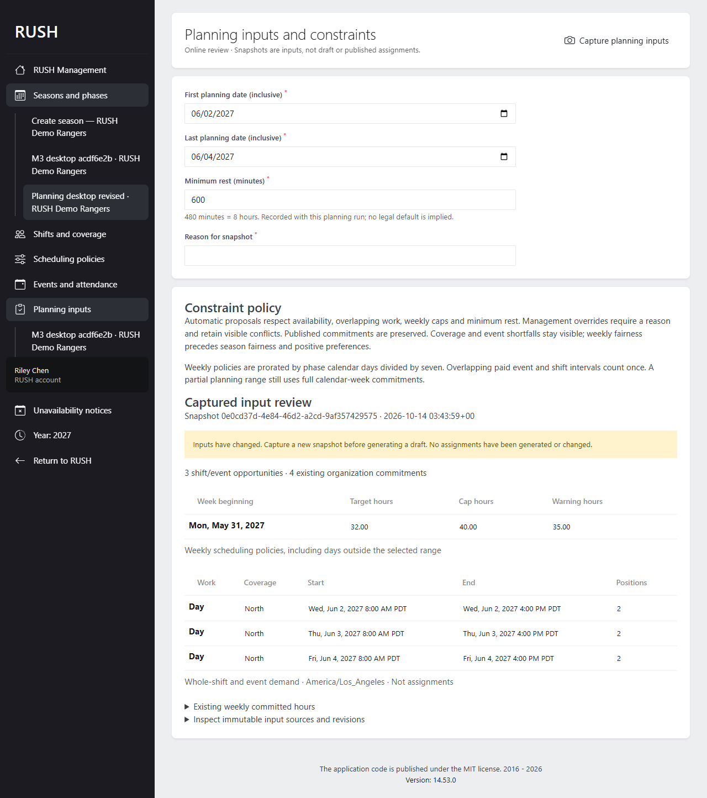
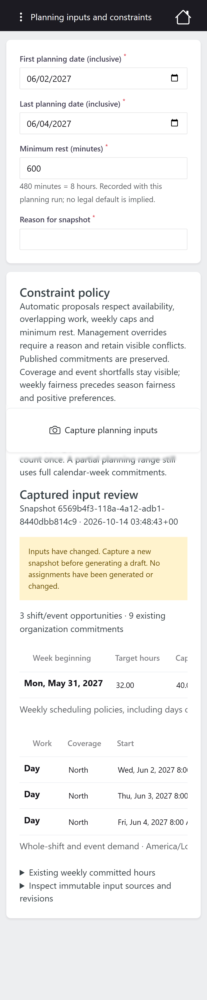

# RUSH-022 verification

Task: Constraint specification and scheduling inputs. Requirements: R-12, R-13.
Target: production. Prerequisites RUSH-001–021 are merged through `f76651d` (PR #22),
including the Milestone 2 offline/conflict gate and Milestone 3 configuration proof.

## Behavior and traceability

| Acceptance | Implementation and evidence |
| --- | --- |
| Hard, overridable and preference constraints (R-13) | Pure `PlanningConstraints`, typed validation, separate codes/reasons and positive preference factors; Pest covers eligibility, duplicate/unknown opportunities, unavailability, overlap, rest, caps, warnings and no silent relaxation |
| Arbitrary planning ranges (R-12) | Inclusive single/multiday range with full overnight opportunities, complete affected weeks and season-zone DST handling; Pest checks partial/mixed-phase weeks, rest boundaries and fold/gap cases |
| Events and weekly limits (R-12/R-13) | Event inputs retain independent number/percentage targets and attendance; union of paid intervals, exact calendar-day weighted caps, unchanged published commitments; Pest verifies paid deduplication, outside-range commitments and next-week allocations |
| Input revisions (R-12) | Immutable audited tenant-bound snapshots with deterministic fingerprint and visible staleness; Pest verifies repeat capture, current permissions, source/roster/preference changes, migration and foreign keys; PostgreSQL independently changes sources mid-capture to verify coherent MVCC |
| Management workflow | Shared API/Orchid services; Playwright `planning-inputs.spec.ts` captures a three-day range with configured ten-hour rest, reloads and displays staleness after a source revision change on desktop/mobile |

Decisions are recorded in [ADR 0022](../../decisions/0022-planning-inputs-and-constraints.md)
and the [API contract](../../contracts/planning-inputs.md). No generation, scoring,
publication or paid-hours mutation is implemented in this task. RUSH-023–028 retain
their ownership. Scenarios 1–2 gain constraint/input evidence; all nine complete
scenario owners remain unchanged. No dependency or offline persistence change.

## Verification record

Executed checks:

- `php vendor/bin/pest --compact --colors=never` against PostgreSQL 17.2:
  **301 passed, 2,049 assertions, no skips** (final full run).
- Initial full SQLite suite: **278 passed, 18 PostgreSQL-only skips**;
  final focused `PlanningInputsTest.php`: **23 passed, 82 assertions** after
  the extra boundary fixtures were added.
- `php vendor/bin/pint --test`: **passed**.
- `npm run client:test`: **173 passed in 17 files**.
- `npm run client:lint`, `npm run client:typecheck`: **passed**, including the
  final browser locator correction.
- `npm run conventions:test`: **8 passed**.
- Production-PWA Docker build, fresh migrations, planning migration rollback and
  reapplication, normal seed and historical-year seed: **passed**.
- All ten new `docker:dev:*` Artisan aliases invoked with `--help`: **passed**.
  Local migration, optimize-clear, route-cache and event-cache help checks passed.
- `git diff --check`: **passed**.
- `composer validate --working-dir=server --strict`: **passed**.
- First full production-PWA `npm run client:test:e2e`: **48 passed in 10.6 minutes**,
  zero retries. Screenshot review then identified narrow wrapped date cells on
  mobile. Table headers/cells now stay on one line within horizontal scrolling;
  the required final full browser rerun is recorded below.
- Final full `npm run client:test:e2e` against the rebuilt production PWA/Server
  and freshly seeded, HTTP-ready fixture: **48 passed in 9.1 minutes**, desktop
  and mobile, zero retries. Desktop and mobile planning screenshots were visually
  inspected; the mobile tables retain readable dates with horizontal scrolling.

The first attempt at that final rerun was stopped after its initial unauthenticated
request received 502: Caddy logged connection refused at 03:38:59 UTC and PHP-FPM
logged ready at 03:39:00. The next five tests passed. The fixture was reset and an
HTTP readiness probe added before restarting the complete suite. No application
assertion or retry policy changed; `docs/testing.md` now records this preflight.

The production-PWA fixture uses `docker/compose.ci.yaml` under the disposable `rush-ci` project.
PostgreSQL unit/concurrency tests use a separate disposable PostgreSQL 17.2 instance
on loopback port 55432, database/user `rush_test`, never the normal application DB.

Initial failures investigated: the new Orchid route needed the explicit Management
middleware allowlist entry; the event migration rollback test needed to roll back
the new dependent planning migration first; the missing-policy fixture needed to
remove its dependent desirability rows before removing the policy. The focused
browser run passed desktop but its mobile test expected Orchid's desktop-only
screen heading. The locator now targets the shared Constraint policy heading;
the trace confirmed that the mobile form was already rendered correctly. These
are corrected without suppressing behavior assertions or skipping tests.

## Deployment and remaining gates

Run the normal migration command to create `planning_inputs`. Rolling this migration
back removes planning snapshots; it does not affect published assignments, events,
availability, preferences or paid hours. No backfill, sync protocol or Dexie migration.
The new development-Compose helpers cover reset/refresh/fresh and cache operations;
generic local/Docker Artisan runners remain available and no alias adds `--force`.
Human review, required CI and merge are still required for task completion.
