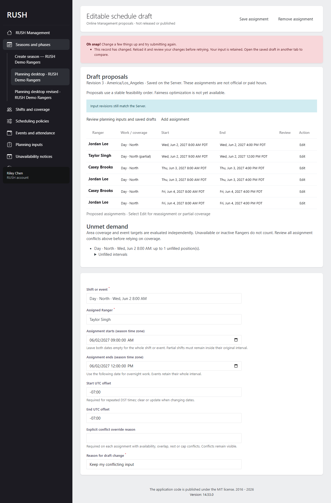
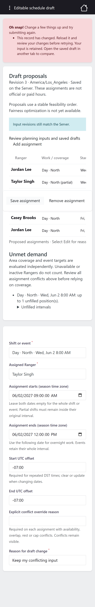

# RUSH-023 verification

Task: Generation and editable drafts. Requirements: R-02, R-06, R-12, R-17.
Target: production. Prerequisites RUSH-001–022 are merged through `5878cfa` (PR #23),
including the Milestone 2 offline conflict gate.

## Acceptance map

| Acceptance | Implementation and tests |
| --- | --- |
| Whole configurable shifts (R-02/R-12) | Snapshot-driven deterministic feasibility generation; Pest covers configurable 24-hour staffing, low-roster shortfalls, unavailability, rest, overlap and caps |
| Event proposals (R-06/R-12) | Independent number/percentage targets; interval-aware scheduled counting; explicit whole-event proposals without official attendance writes; Pest covers both counting modes and partial event rejection |
| Editable and partial assignments (R-02/R-12) | Shared Management API/Orchid service; add/reassign/shorten/remove, UTC intervals inside original shifts, per-candidate override reasons, complete-set validation; DST fold and overnight cases |
| Preserve published records (R-17 boundary) | Separate draft tables; existing published work constrains generation and contextual coverage contributes to demand; tests prove official records/history and event attendance remain unchanged |
| Audit and concurrent review | Tenant foreign keys, transactional before/after revisions, audit failure rollback, stale source protection, current permissions, archive guards; PostgreSQL independent-process competing writes accept exactly one revision |
| Management browser journey | Desktop/mobile generation, reassignment, partial edit, reload, retained conflicting input, removal and manual whole-shift addition; mobile page-width assertion |

See [ADR 0023](../../decisions/0023-editable-schedule-drafts.md) and
[API contract](../../contracts/schedule-drafts.md). Generation is a feasibility
baseline; RUSH-024 retains fairness weights/scoring, RUSH-025 retains official gap
accounting/recommendations, RUSH-027/028 retain release and publication. Scenarios
1–2 and 6 gain proposal evidence; no complete release scenario is claimed here.

## Executed verification

- Full `php vendor/bin/pest --compact --colors=never` on disposable PostgreSQL
  17.2: **318 passed, 2,134 assertions, no skips**.
- Final focused `php vendor/bin/pest tests/Feature/ScheduleDraftsTest.php
  tests/Feature/ScheduleDraftConcurrencyTest.php --compact --colors=never` on
  PostgreSQL: **25 passed, 113 assertions**, including subsequently added boundary
  cases and stale removal handling. This follows the full regression run above.
- Expanded SQLite draft run: **23 passed, 105 assertions** before the final
  stale-removal case was added; the PostgreSQL run covers that final case.
- `npm run client:test`: **173 passed in 17 files**.
- `npm run conventions:test`: **8 passed**. Its initial sandbox run could not
  initialize a temporary Git repository; it passed with filesystem access.
- All **23 new `docker:dev:*` Artisan aliases** invoked through npm with `--help`:
  **passed**; no operational/destructive command was executed by this check.

- Final `npm --prefix client run test:e2e -- schedule-drafts.spec.ts
  planning-inputs.spec.ts` against the rebuilt, freshly seeded production-PWA
  image: **4 passed** (desktop/mobile, zero retries), including manual addition,
  reassignment and page-width checks. Both final screenshots were visually reviewed.
- `npm run client:lint`, `npm run client:typecheck`, `php vendor/bin/pint --test`,
  `composer validate --strict` and `git diff --check`: **passed**.
- `docker compose -f docker/compose.ci.yaml up -d --build --wait --wait-timeout 180`:
  **passed**, including the production PWA build. Draft migration rollback with
  `migrate:rollback --step=1 --force`, reapplication with `migrate --force`, fresh
  migrations/seed, historical-year seed and HTTP readiness probe: **passed**.

Initial browser runs exposed an Orchid `formnovalidate` value
requirement, test datetime normalization and navigation races. Screenshot review
found mobile action overflow and accessible hidden labels extending outside their
scroll region; the labels are now contained
by a positioned scroll region. Tests retain zero retries and verify real services.

## Deployment and review

Run the normal migration command to create `schedule_drafts`, `draft_assignments`
and `draft_changes` plus the tenant-bound snapshot key. Rollback removes proposals
and their history only; inputs, published assignments and event attendance remain.
No backfill, new dependency, Dexie schema, sync protocol or Workbox change.

Testing uses `docker/compose.ci.yaml` under disposable project `rush-ci`, and a
separate disposable PostgreSQL instance on loopback port 55432. Human review,
required CI checks and merge remain necessary for task completion.
